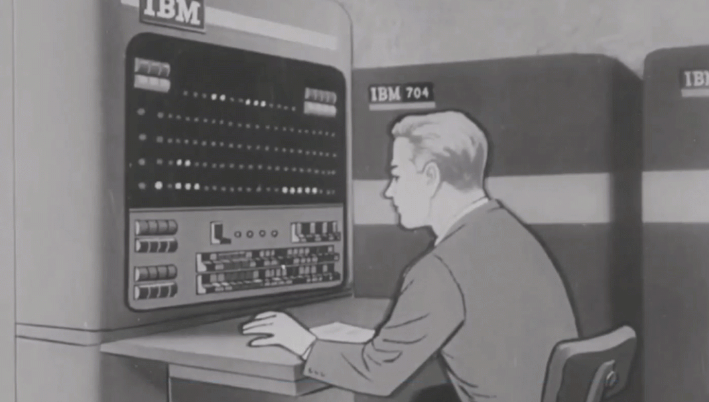

# 💡 Computer Science 50 
CS50 (Computer Science 50) is a comprehensive introduction to computer science, taught by Harvard University. 

### About this reporitory
This repository may contains my personal notes, based on my understanding of the course.

---

### CS50: Note
Despite the great content of the course, CS50 will not give you a full explanation of how things work. For instance, in the beginning, you'll learn what a compiler is, what memory addresses are, and so on.. but you won’t truly understand how these things work under the hood. For deeper understanding, you’ll need to research and explore on your own.

At this stage, it's unlikely you'll have truly hard questions. They may feel challenging, but most can be answered with a quick Google search. Avoid asking others for help with basic or common questions in computer science (or any other scientific field),  it can be frustrating for them and is often unnecessary since search engines exist.

#### TD;LR
**CS50 is a great starting point for learning low-level programming concepts. But treat it as the first step in a much larger journey.**

---
  
| 🗓️ Week      | 📌 Topic covered | 📝 Problems set |
| :------------| :----------------: | :---------------:|
| 00 -    scratch &nbsp; | Introduction to computer science: bits, data, information. |  [games  📁...](https://scratch.mit.edu/users/FireguiQueen/projects/) |
| 01 - c       | Introduction to programming using C | [making a pyramid through an algorithm 📁...](https://github.com/FireguiQueen/havard-cs50/tree/main/week-01_c/problem-set/mario.c),   [luhn's algorithm written in C 📁...](https://github.com/FireguiQueen/havard-cs50/tree/main/week-01_c/problem-set/credit.c) |
| 02 - array   | Programming using C | [scrabble game 📁...](https://github.com/FireguiQueen/havard-cs50/tree/main/week-02_array/problem-set/scrabble.c),   [readability 📁...](https://github.com/FireguiQueen/havard-cs50/tree/main/week-02_array/problem-set/readability.c),   [substitution 📁...](https://github.com/FireguiQueen/havard-cs50/tree/main/week-02_array/problem-set/substitution.c) |

## 🧑‍🏫 Instructors
- **David J. Malan** - Gordon Mckay Professor of the Practice of Computer Science at Harvard University.
- **Doug Lloyd** - Senior Preceptor in Computer Science at Harvard University.
- **Brian Yu** - Senior Preceptor in Computer Science at Harvard University.

-------------------

### 🔗 Useful links
+ [ [ Weeks ] ](https://cs50.harvard.edu/x/)
+ [ [ View your progress ] ](https://cs50.me/cs50x)
+ [ [ CS50 - Wiki ] ](https://en.wikipedia.org/wiki/CS50)

-------------------

### 🎓 Certificate
If you submit and receive a score of at least 70% on each of this course’s problem sets as well as its final project, you will be eligible for a free CS50 Certificate like the below. For a verified certificate from edX, register at cs50.edx.org. Check the FAQs for additional information, and if your question is not covered there please email certificates@cs50.harvard.edu, and we’ll do our best to help.

